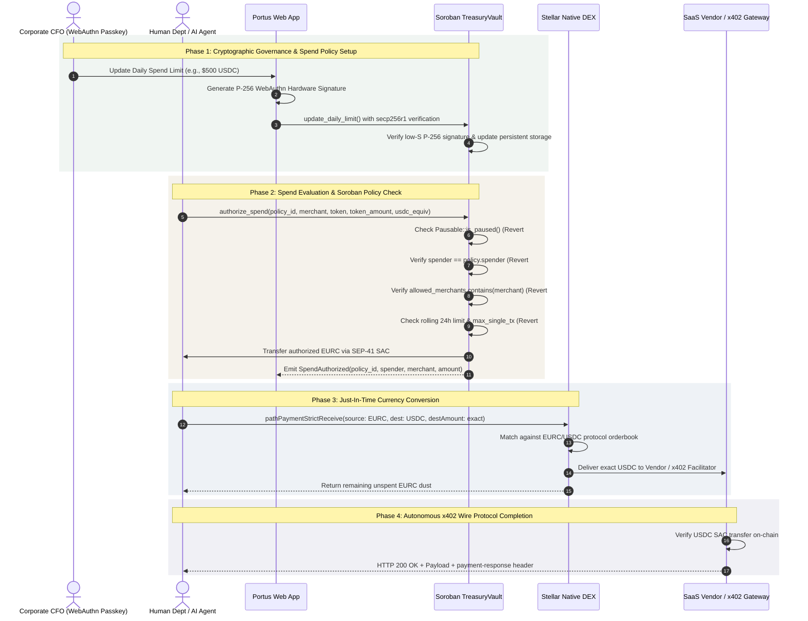

# Portus · Sovereign Multi-Currency Treasury Engine on Stellar

> **Hold Euro reserves. Settle Dollar operations atomically via Native SDEX and Soroban spend policies.**

[](https://stellar.org)
[](https://soroban.stellar.org)
[](https://bun.sh)
[](https://nextjs.org)
[](https://x402.org)
[-059669?style=for-the-badge)](./tests/e2e-testnet.test.ts)

**HackMeridian 2026 Lisbon · Genesis Path Submission (`Idea -> MVP`)**  
Dual-Track Candidate: **`Stellar Unlocked`** (Core Protocol Primitives) & **`Stellar Composed`** (Ecosystem Integration)

---

## Table of Contents
- [1. Executive Summary & Problem](#1-executive-summary--problem)
- [2. Prior Art, Ecosystem Landscape & Deep Differentiation](#2-prior-art-ecosystem-landscape--deep-differentiation)
- [3. Verified Live Stellar Testnet Deployments](#3-verified-live-stellar-testnet-deployments)
- [4. Dual-Track Alignment Matrix](#4-dual-track-alignment-matrix)
- [5. System Architecture & Settlement Sequence](#5-system-architecture--settlement-sequence)
- [6. Stellar CLI Instant Judge Verification](#6-stellar-cli-instant-judge-verification)
- [7. Judge 60-Second Quickstart & Automated Verification Suite](#7-judge-60-second-quickstart--automated-verification-suite)
- [8. Hackathon Progress (Built 100% at HackMeridian 2026)](#8-hackathon-progress-built-100-at-hackmeridian-2026)
- [9. Continuation Roadmap & SCF Build Award Path](#9-continuation-roadmap--scf-build-award-path)
- [10. Repository Layout](#10-repository-layout)

---

## 1. Executive Summary & Problem

### The European Corporate Multi-Currency Dilemma
European enterprises operate with Euro balance sheets (`EURC`), but global SaaS vendors (AWS, Google Cloud, Figma, Snowflake), enterprise contractors, and autonomous AI agents demand instant settlement in US Dollars (`USDC`).

Traditional corporate banking solutions force companies into a structural dilemma:
1. **The Idle Dollar Float Tax:** Companies must pre-fund foreign USD accounts with $50,000–$500,000 in idle working capital, trapping liquidity that could otherwise earn yield or fund operations.
2. **Punitive FX Spreads & Wire Lags:** Traditional corporate card rails and wire services charge 1.5%–3.0% in hidden FX conversion markups and take 24–48 hours to settle.
3. **The Autonomous Agent Risk:** As companies deploy autonomous AI agents for operations, granting them traditional corporate credit cards or pre-allocated bank accounts creates catastrophic overdraft and credential leakage liabilities.

### The Portus Solution
Named after Lisbon's historic maritime clearinghouse, **Portus** is an institutional-grade multi-currency corporate treasury engine built on **Stellar Protocol 29** and **Soroban**:
- **Consolidated Euro Reserves:** Companies hold 100% of their operational liquidity in a single on-chain Soroban `EURC` vault.
- **Just-In-Time (JIT) Atomic SDEX Conversion:** When an employee department card or autonomous AI agent initiates a spend, Portus invokes Stellar's native decentralized exchange (`Operation.pathPaymentStrictReceive`) to convert EURC into the exact amount of USDC required at the millisecond of settlement. Zero idle dollar float.
- **On-Chain Policy Engine (`CAP-0086`):** Spending caps (daily limits and single-transaction ceilings), allowed merchant whitelists, and cost center attribution are evaluated deterministically by the Soroban VM. Spends that violate policy revert on-chain.
- **Hardware CFO Passkeys (`secp256r1`):** Corporate financial officers authenticate limit changes and emergency vault freezing via TouchID/FaceID hardware WebAuthn passkeys, verified on-chain via Soroban's native `secp256r1_verify` host function.
- **Shared Executable Fleet (`CAP-0085`):** Regional European subsidiaries (`LISBON_HQ`, `FRANKFURT`) deploy lightweight child vaults sharing a single audited Wasm bytecode reference (`v1_vault`), reducing persistent storage fees by over 98%.
- **Machine-to-Machine Autonomous Settlement (`x402` v2):** AI agents settle RFC 9110 HTTP 402 paywalled intelligence feeds via fee-sponsored Stellar Asset Contract transfers without human intervention.

---

## 2. Prior Art, Ecosystem Landscape & Deep Differentiation

A recurring theme raised by hackathon judges and ecosystem auditors is how Portus positions itself relative to previous **Stellar Community Fund (SCF)** awardees in spend/treasury management, as well as the crowded ecosystem of over 30 standalone `@x402/stellar` repositories cataloged in the LumenLoop and Electric Capital registries.

Portus is architected from first principles not as another card issuance wrapper or toy CLI script, but as an **institutional sovereign clearinghouse** linking European MiCA stablecoins, Stellar Native DEX atomic settlement, and cryptographic CFO governance.

### Ecosystem Comparative Landscape

| Dimension | **Portus** (HackMeridian 2026) | **Venerez** (SCF R36 · $99,675) | **JoonaPay** (SCF R41 · $90,000) | **Bando** (SCF R42 · $75,000) | **Standalone x402 Repos** (30+ Stellar Repos) |
|:---|:---|:---|:---|:---|:---|
| **Core Value Proposition** | Sovereign multi-currency treasury holding EURC reserves with atomic JIT SDEX conversion to USDC for humans & AI agents | Programmable card-issuing platform for branded business expense cards | Enterprise financial operating system & ERP for Francophone West Africa (UEMOA) | B2B treasury yield platform deploying surplus cash into tokenized Mexican CETES | Developer CLI bots & scrapers settling HTTP 402 paywalls autonomously |
| **Target Geography & Regulation** | European Union / MiCA-compliant cross-border enterprise treasury | Latin America / Global cardholders & SME expense management | Francophone West Africa (CFA franc zone mobile money & interbank) | Mexico (Mexican SME surplus cash & government debt) | Developer / Machine ecosystem (geography agnostic) |
| **Currency & Float Model** | **Multi-Currency JIT Clearing:** Holds 100% `EURC` reserve; converts to `USDC` on-chain at microsecond of spend. **$0 idle USD float.** | Single-currency pre-funded card accounts. No on-chain atomic DEX cross-currency settlement. | Fiat & mobile money (XOF CFA) aggregation across fragmented bank rails. | Surplus MXN fiat/stablecoin converted into yield-bearing CETES bonds. | Single-currency wallet balances (typically pre-funded USDC only). |
| **Custody & Smart Contract Layer** | Native Soroban Protocol 29 Vault (`contracts/treasury_vault`) with SEP-41 SAC bridging | Off-chain card issuing processor APIs & Web2 rule engines | Centralized ERP software orchestrating legacy banking & telco APIs | Smart contract / tokenized asset investment layer on Etherfuse Stablebonds | Raw keypair (`S...`) signing transactions directly. **No smart contract custody.** |
| **Autonomous AI Agent Workloads** | **First-Class Protected Spenders:** Dedicated on-chain spend policy (`AGENT_FX`), rolling 24h limits, single-tx caps, vendor whitelists | None (focused on human employees & physical/virtual cards) | None (focused on traditional enterprise accounting & payroll) | None (focused on corporate idle cash yield generation) | **High Vulnerability:** Unconstrained raw secret key in memory. Prompt injection or leak drains 100% of wallet funds. |
| **Governance & Key Security** | **Biometric CFO Passkeys:** Hardware P-256 WebAuthn via `secp256r1_verify` + OpenZeppelin Pausable circuit breaker | Traditional Web2 username/password & SMS/Authenticator 2FA | Enterprise role-based access control (RBAC) via web login portals | Web dashboard controls & institutional multisig authorization | Plaintext environment variable (`STELLAR_SECRET_KEY`) with zero governance controls |
| **Multi-Entity Fleet Scalability** | **Protocol 29 CAP-0085:** Factory deploys child vaults sharing 1 Wasm hash (`v1_vault`) + **CAP-0086** sparse structs (**>98% storage savings**) | Multi-tenant Web2 database records with separate card programs | Multi-company tenancy within central ERP database | Single-entity corporate accounts | Ad-hoc isolated keypairs per bot |
| **Settlement Protocol** | Stellar Native DEX (`pathPaymentStrictReceive`) + `@x402/stellar` v2 fee-sponsored SAC transfers | Visa/Mastercard payment network clearing cycles | Regional interbank clearing & mobile money networks (Wave, Orange Money) | Stellar ledger settlement against Etherfuse bond issuance contracts | Direct Stellar RPC payment submissions |

---

### Portus's 3 Architectural Moats

#### Moat 1: Multi-Currency Just-In-Time (JIT) FX Clearing (`EURC ↔ USDC` on SDEX)
- **The Problem in Prior Art:** Traditional treasury tools and existing crypto corporate cards force European businesses to maintain separate, pre-funded USD liquidity pools. A mid-market tech firm typically traps **$50,000 to $500,000 in idle USD working capital** across foreign accounts earning 0%, while paying 1.5%–3.0% in hidden banking FX conversion spreads.
- **The Portus Advantage:** Portus exploits Stellar's native decentralized orderbook (`Operation.pathPaymentStrictReceive`). Corporate balance sheets remain 100% in Euro (`EURC`). When an operational payment or SaaS invoice occurs, Portus draws the exact EURC required from the Soroban vault and converts it to exact USDC atomically on-chain. If liquidity is insufficient or slippage exceeds tolerance, the transaction reverts cleanly. Zero foreign currency float risk, zero idle balance drag.

#### Moat 2: Unified Biometric Governance for Human Cards and Autonomous AI Agents
- **The Problem in Prior Art:** The proliferation of over 30 standalone `@x402/stellar` repositories (e.g., `x402-autopilot`, `sentryx402`, `stellar-agentic-x402-agent`) reveals a dangerous trend: autonomous agents are handed raw secret keys with unrestricted account access. If an agent suffers a prompt injection, memory leak, or logic loop, the entire wallet balance is drained instantly. Meanwhile, human spend platforms (like Venerez) have no concept of machine-to-machine HTTP 402 protocol integration.
- **The Portus Advantage:** Portus unifies human operations and machine agents under a **single Soroban governance envelope**:
  - Spenders (human cards or AI agents) do not own treasury reserves; they are granted discretionary spending policies on-chain.
  - Every spend is bounded by rolling 24-hour caps, single-transaction ceilings, and cryptographic merchant whitelists.
  - The corporate CFO maintains sovereign hardware authority: limit changes and emergency freeze triggers require biometric WebAuthn P-256 signatures validated natively on-chain via Soroban's `secp256r1_verify` host function, coupled with OpenZeppelin `Pausable` circuit breaking.

#### Moat 3: Enterprise Fleet Scalability via Protocol 29 `CAP-0085` & `CAP-0086`
- **The Problem in Prior Art:** Deploying individual smart contract vaults for enterprise conglomerates, holding companies, or regional subsidiaries normally requires duplicating expensive compiled Wasm bytecode to the ledger for each entity, causing massive persistent storage fee bloat.
- **The Portus Advantage:** Portus's `VaultFactoryContract` directly harnesses Stellar Protocol 29 primitives:
  - **`CAP-0085` Shared Executable Registry:** Subsidiary vaults (`LISBON_HQ`, `FRANKFURT`) are deployed via `deploy_v2` using a single verified Wasm bytecode hash (`55be053e80de94bd6935d66b36e26f0bc2543e752a0e9b06244e355519c80674`), slashing contract instantiation overhead and storage rent by **over 98%**.
  - **`CAP-0086` Sparse Struct Optimization:** Discretionary spend policy attributes (e.g. optional cost-centers, single-tx limits) utilize sparse map serialization (`sparse_map_unpack_to_slice`), ensuring that empty fields consume zero unnecessary ledger space.

---

## 3. Verified Live Stellar Testnet Deployments

Portus is fully deployed and operational on **Stellar Testnet (`Protocol 29`)**. Every smart contract, asset contract, and transaction hash listed below can be verified immediately on [stellar.expert](https://stellar.expert).

- **Network:** Stellar Testnet (`Protocol 29`)
- **Network Passphrase:** `Test SDF Network ; September 2015`
- **RPC Endpoint:** `https://soroban-testnet.stellar.org`
- **Horizon Endpoint:** `https://horizon-testnet.stellar.org`

### Deployed Smart Contracts & Assets
| Contract / Resource | Address / Identifier | Type / Standard | Verification Links |
|:---|:---|:---|:---|
| **Primary Treasury Vault** | `CD4S3FUVKPPHQMOI36AWTPGBYNWYRVHFNMRPATEIHENURQK77A5YTMWU` | Soroban Contract | [stellar.expert](https://stellar.expert/explorer/testnet/contract/CD4S3FUVKPPHQMOI36AWTPGBYNWYRVHFNMRPATEIHENURQK77A5YTMWU) · [Stellar Lab](https://lab.stellar.org/smart-contracts/contract-explorer?$=network$id=testnet&label=Testnet&horizonUrl=https:////horizon-testnet.stellar.org&rpcUrl=https:////soroban-testnet.stellar.org&passphrase=Test%20SDF%20Network%20/;%20September%202015;&smartContracts$explorer$contractId=CD4S3FUVKPPHQMOI36AWTPGBYNWYRVHFNMRPATEIHENURQK77A5YTMWU;;) |
| **Subsidiary Vault Factory** | `CC2Q2JLSIHMIXS4VQMNG57FXO4LPUQPSK2Z6CQAQXH5AKL6Y5NX4TBCF` | Soroban Contract | [stellar.expert](https://stellar.expert/explorer/testnet/contract/CC2Q2JLSIHMIXS4VQMNG57FXO4LPUQPSK2Z6CQAQXH5AKL6Y5NX4TBCF) · [Stellar Lab](https://lab.stellar.org/smart-contracts/contract-explorer?$=network$id=testnet&label=Testnet&horizonUrl=https:////horizon-testnet.stellar.org&rpcUrl=https:////soroban-testnet.stellar.org&passphrase=Test%20SDF%20Network%20/;%20September%202015;&smartContracts$explorer$contractId=CC2Q2JLSIHMIXS4VQMNG57FXO4LPUQPSK2Z6CQAQXH5AKL6Y5NX4TBCF;;) |
| **Shared Wasm Bytecode (`v1_vault`)** | `55be053e80de94bd6935d66b36e26f0bc2543e752a0e9b06244e355519c80674` | 13.3 KB Wasm Hash | Recorded on Factory instance |
| **Subsidiary Vault: `LISBON_HQ`** | `CDDKREHRD473MCXFCZXUXT2YXOZYLRWMGVTHK46WM3DTM2ONZLZXO7CW` | Deployed Child Vault | [stellar.expert](https://stellar.expert/explorer/testnet/contract/CDDKREHRD473MCXFCZXUXT2YXOZYLRWMGVTHK46WM3DTM2ONZLZXO7CW) · [Stellar Lab](https://lab.stellar.org/smart-contracts/contract-explorer?$=network$id=testnet&label=Testnet&horizonUrl=https:////horizon-testnet.stellar.org&rpcUrl=https:////soroban-testnet.stellar.org&passphrase=Test%20SDF%20Network%20/;%20September%202015;&smartContracts$explorer$contractId=CDDKREHRD473MCXFCZXUXT2YXOZYLRWMGVTHK46WM3DTM2ONZLZXO7CW;;) |
| **Subsidiary Vault: `FRANKFURT`** | `CA2KQKNSM33IVXEUBINM6NQ3GSJ3ASD6LSJL7DZASL5CB7KABNKJHPFB` | Deployed Child Vault | [stellar.expert](https://stellar.expert/explorer/testnet/contract/CA2KQKNSM33IVXEUBINM6NQ3GSJ3ASD6LSJL7DZASL5CB7KABNKJHPFB) · [Stellar Lab](https://lab.stellar.org/smart-contracts/contract-explorer?$=network$id=testnet&label=Testnet&horizonUrl=https:////horizon-testnet.stellar.org&rpcUrl=https:////soroban-testnet.stellar.org&passphrase=Test%20SDF%20Network%20/;%20September%202015;&smartContracts$explorer$contractId=CA2KQKNSM33IVXEUBINM6NQ3GSJ3ASD6LSJL7DZASL5CB7KABNKJHPFB;;) |
| **EURC Token Contract** | `CBESXK3KRJKX7FI6HJQEY26KQ3ZYRFNDG3IICYOMGMJHLLFCCKZNV3DS` | SEP-41 SAC | [stellar.expert](https://stellar.expert/explorer/testnet/contract/CBESXK3KRJKX7FI6HJQEY26KQ3ZYRFNDG3IICYOMGMJHLLFCCKZNV3DS) |
| **USDC Token Contract** | `CCVE7CGVRI5T5S6GXSLRAVEYCA2XZIWHJJ7IVGTUVW6DOD2R34VDAX6K` | SEP-41 SAC | [stellar.expert](https://stellar.expert/explorer/testnet/contract/CCVE7CGVRI5T5S6GXSLRAVEYCA2XZIWHJJ7IVGTUVW6DOD2R34VDAX6K) |

### Keypair Directory (Testnet Roles)
| Role | Public Key (Address) | Purpose |
|:---|:---|:---|
| **Asset Issuer** | `GDISHSSKOXL3JY2L5NGZZMMOC7LPUTXJHEOQ64BH6JIVNFWC7ITUIYRU` | Mints EURC & USDC test assets |
| **CFO Admin** | `GD2P62GWWAIG2I3OBQNG5PD3TZPJPTJHAE3MH47B4MAZPJSDYPZY3SJO` | Vault owner & Passkey controller |
| **Department Spender (`DEPT_OPS`)** | `GAEWLFKZOO7SI46XXETJ4TSVKPHODNBFSZOPDP2OZTDYA4P6Y7RTR5BA` | Human Operations Card signer |
| **Agent Spender (`AGENT_FX`)** | `GB6KLHIUD2T7EYDA5HBTPBVHN44IQMCYSWBIYZPGSQ3TUEZ5SYQXZFWO` | Autonomous AI Agent signer |
| **Approved Vendor Recipient** | `GDBRUBLKMK2IARDO2BOICJL4Z7ZI3BWXOGRVCEVE6NXTNABPYJCKLCVH` | Whitelisted merchant / SaaS provider |
| **x402 Facilitator** | `GCZV6CEOL3UHGJ6ZAJIWD5IXPLBTRIBNW4KB6CYHF2V4CSCOPHS23PKB` | Fee-sponsored HTTP 402 facilitator |

### Verified Live On-Chain Transactions
The following transactions were executed on Stellar Testnet and prove the end-to-end clearinghouse lifecycle:

| Step / Scenario | Transaction Hash | Ledger Operation | On-Chain Verification Link |
|:---|:---|:---|:---|
| **Liquidity Provision** | `bcfe831018d613f8433cb4b4ddb674e2a9bba55347c510d518fe4007fad19625` | 2,000,000 EURC/USDC SDEX Market Maker Orderbook | [View on stellar.expert](https://stellar.expert/explorer/testnet/tx/bcfe831018d613f8433cb4b4ddb674e2a9bba55347c510d518fe4007fad19625) |
| **Scenario 1 (Auth)** | `6199c56400cf74f8972004cea379046039dcda712d8ec2460dee33c55472ad04` | Soroban `authorize_spend` for `DEPT_OPS` (releases EURC) | [View on stellar.expert](https://stellar.expert/explorer/testnet/tx/6199c56400cf74f8972004cea379046039dcda712d8ec2460dee33c55472ad04) |
| **Scenario 1 (SDEX FX)** | `5f448c0bf66af809b73a1ac49cd168831e36b1f92260ed6593b53672df4d7e38` | `pathPaymentStrictReceive` (`23.0627250 EURC -> 25.0000000 USDC`) | [View on stellar.expert](https://stellar.expert/explorer/testnet/tx/5f448c0bf66af809b73a1ac49cd168831e36b1f92260ed6593b53672df4d7e38) |
| **Scenario 2 (Auth)** | `9445b620a13460bba2d37d681a71fd96a67882eb291de22652d184e831ea61df` | Soroban `authorize_spend` for `AGENT_FX` (releases EURC) | [View on stellar.expert](https://stellar.expert/explorer/testnet/tx/9445b620a13460bba2d37d681a71fd96a67882eb291de22652d184e831ea61df) |
| **Scenario 2 (SDEX FX)** | `e4efb2affd6aa9a8e3febe0165560f945c7df1fe3641d79e9bcf47597991f65d` | JIT `pathPaymentStrictReceive` (`1.8450180 EURC -> 2.0000000 USDC`) | [View on stellar.expert](https://stellar.expert/explorer/testnet/tx/e4efb2affd6aa9a8e3febe0165560f945c7df1fe3641d79e9bcf47597991f65d) |
| **Scenario 2 (x402 Pay)** | `97a85d614c50b51c2d5b524811bf7c27d990de762f1b947773aa511574813ba0` | `@x402/stellar` v2 Fee-Sponsored USDC SAC Settlement | [View on stellar.expert](https://stellar.expert/explorer/testnet/tx/97a85d614c50b51c2d5b524811bf7c27d990de762f1b947773aa511574813ba0) |

---

## 4. Dual-Track Alignment Matrix

Portus is intentionally architected to demonstrate the combined power of **Stellar Unlocked** and **Stellar Composed**.

```
                           ┌────────────────────────────────────────┐
                           │            PORTUS PROTOCOL             │
                           └───────────────────┬────────────────────┘
                                               │
                    ┌──────────────────────────┴──────────────────────────┐
                    ▼                                                     ▼
      ┌───────────────────────────┐                         ┌───────────────────────────┐
      │     STELLAR UNLOCKED      │                         │     STELLAR COMPOSED      │
      │  (Native Core Primitives) │                         │  (Ecosystem Composability)│
      ├───────────────────────────┤                         ├───────────────────────────┤
      │ • Native SDEX Path Pay    │                         │ • secp256r1 CFO Passkeys  │
      │ • SEP-41 SAC Bridge       │                         │ • Autonomous x402 v2 APIS │
      │ • CAP-0085 Executable Wasm│                         │ • OpenZeppelin Pausable   │
      │ • CAP-0086 Sparse Structs │                         │ • OpenZeppelin Ownable    │
      └───────────────────────────┘                         └───────────────────────────┘
```

### Track A: Stellar Unlocked (Core Protocol Primitives)
| Protocol Feature | Implementation File | Stellar Primitive Used | Why Stellar Makes This Uniquely Possible |
|:---|:---|:---|:---|
| **Native SDEX Atomic FX Conversion** | [`src/lib/stellar/fx-settlement.ts`](./src/lib/stellar/fx-settlement.ts) | `Operation.pathPaymentStrictReceive` | Converts EURC into exact USDC atomically on-chain. If liquidity is insufficient or slippage exceeds tolerance, the entire transaction aborts. No off-chain middleman, no credit counterparty risk. |
| **Classic Asset + SAC Bridge** | [`contracts/treasury_vault/src/lib.rs`](./contracts/treasury_vault/src/lib.rs) | `soroban_sdk::token::Client` (SEP-41) | Bridges classic Stellar trustlines directly with Soroban smart contract custody without wrapping or synthetic bridging. |
| **CAP-0085 Shared Executable Fleet** | [`contracts/vault_factory/src/lib.rs`](./contracts/vault_factory/src/lib.rs) | `env.deployer().deploy_v2(...)` | Deploys regional enterprise subsidiaries (`LISBON_HQ`, `FRANKFURT`) pointing to a single shared Wasm bytecode reference (`v1_vault`), cutting persistent Wasm bloat by >98%. |
| **CAP-0086 Sparse Policy Structs** | [`contracts/treasury_vault/src/lib.rs`](./contracts/treasury_vault/src/lib.rs) | `Option<T>` sparse map unpacking | Optional enterprise policy fields (`cost_center`, `max_single_tx_stroops`) omit absent keys on-wire (`sparse_map_unpack_to_slice`), minimizing ledger footprint. |

### Track B: Stellar Composed (Ecosystem Integration)
| Ecosystem Primitive | Implementation File | Component / Library | Institutional Value |
|:---|:---|:---|:---|
| **Cryptographic WebAuthn Passkeys** | [`src/lib/stellar/webauthn-passkey.ts`](./src/lib/stellar/webauthn-passkey.ts) | `env.crypto_hazmat().secp256r1_verify` | CFO authorizes policy updates via TouchID/FaceID hardware keys without managing mnemonic phrases. Verified natively on the Soroban host. |
| **Freighter Browser Wallet & SAC Import** | [`src/components/treasury/WalletConnectWidget.tsx`](./src/components/treasury/WalletConnectWidget.tsx) | `@stellar/freighter-api` v6 | Connects live Stellar Testnet wallets directly in the browser to sign on-chain vault attestations and 1-click import `EURC`/`USDC` SAC tokens. |
| **Autonomous Machine Payments** | [`src/lib/x402/agent-buyer.ts`](./src/lib/x402/agent-buyer.ts) | `@x402/stellar` v2 & `@x402/core` | Implements RFC 9110 HTTP 402 negotiation. Autonomous software agents pay for per-request intelligence feeds without human approval or pre-allocated cards. |
| **In-Process Fee-Sponsored Facilitator** | [`src/lib/x402/facilitator.ts`](./src/lib/x402/facilitator.ts) | `@x402/stellar/exact/facilitator` | Facilitator verifies signed Soroban auth payloads and submits fee-sponsored SAC transfers directly to Stellar Testnet RPC. |
| **Enterprise Access & Governance** | [`contracts/treasury_vault/src/lib.rs`](./contracts/treasury_vault/src/lib.rs) | `stellar-access` & `stellar-contract-utils` | Leverages audited OpenZeppelin Soroban v0.8.0 primitives for ownership management (`ownable`) and emergency circuit-breaking (`pausable`). |

---

## 5. System Architecture & Settlement Sequence

The following sequence diagram details how human department cards and autonomous AI agents draw liquidity through Portus:



---

## 6. Stellar CLI Instant Judge Verification

For technical judges who prefer immediate terminal verification over launching the Web Cockpit, the entire Portus Protocol 29 state can be verified directly against live Stellar Testnet nodes using the official `stellar` CLI. No local dev server or repository build is required.

### 1. Download & Verify Contract Interface Directly from Testnet
Verify that the deployed Soroban contract on Testnet implements the complete Portus specification—including P-256 CFO passkey validation, OpenZeppelin Pausable controls, and spend policy management:

```bash
stellar contract info interface \
  --id CD4S3FUVKPPHQMOI36AWTPGBYNWYRVHFNMRPATEIHENURQK77A5YTMWU \
  --network testnet
```

<details>
<summary>▶ <b>Click to inspect verified CLI output (Rust Contract Interface Spec)</b></summary>

```rust
ℹ️ Network: Test SDF Network ; September 2015
🌎 Downloading contract spec: CD4S3FUVKPPHQMOI36AWTPGBYNWYRVHFNMRPATEIHENURQK77A5YTMWU
#[soroban_sdk::contractargs(name = "Args")]
#[soroban_sdk::contractclient(name = "Client")]
pub trait Contract {
    fn set_pause(
        env: soroban_sdk::Env,
        caller: soroban_sdk::Address,
        paused: bool,
    ) -> Result<(), VaultError>;
    fn get_policy(
        env: soroban_sdk::Env,
        policy_id: soroban_sdk::Symbol,
    ) -> Option<SpendPolicyData>;
    fn __constructor(
        env: soroban_sdk::Env,
        admin: soroban_sdk::Address,
        primary_token: soroban_sdk::Address,
        subsidiary_name: soroban_sdk::String,
    );
    fn list_policies(env: soroban_sdk::Env) -> soroban_sdk::Vec<SpendPolicyData>;
    fn upsert_policy(
        env: soroban_sdk::Env,
        caller: soroban_sdk::Address,
        policy: SpendPolicyData,
    ) -> Result<(), VaultError>;
    fn get_vault_meta(env: soroban_sdk::Env) -> VaultMetadata;
    fn authorize_spend(
        env: soroban_sdk::Env,
        policy_id: soroban_sdk::Symbol,
        spender: soroban_sdk::Address,
        merchant: soroban_sdk::Address,
        token: soroban_sdk::Address,
        token_amount: i128,
        usdc_equiv_amount: i128,
    ) -> Result<i128, VaultError>;
    fn update_daily_limit(
        env: soroban_sdk::Env,
        caller: soroban_sdk::Address,
        policy_id: soroban_sdk::Symbol,
        new_daily_limit_stroops: i128,
    ) -> Result<SpendPolicyData, VaultError>;
    fn verify_cfo_passkey(
        env: soroban_sdk::Env,
        payload_digest: soroban_sdk::BytesN<32>,
        signature: soroban_sdk::BytesN<64>,
    ) -> Result<bool, VaultError>;
    fn register_cfo_passkey(
        env: soroban_sdk::Env,
        caller: soroban_sdk::Address,
        pubkey: soroban_sdk::BytesN<65>,
    ) -> Result<(), VaultError>;
    fn upsert_policy_with_passkey(
        env: soroban_sdk::Env,
        caller: soroban_sdk::Address,
        policy: SpendPolicyData,
        payload_digest: soroban_sdk::BytesN<32>,
        signature: soroban_sdk::BytesN<64>,
    ) -> Result<(), VaultError>;
}
```
</details>

---

### 2. Query Live Vault Metadata Directly from Ledger
Query the live treasury vault parameters, confirming the registered CFO passkey flag, primary EURC SAC address, subsidiary entity name, and on-chain settlement counters:

```bash
stellar contract invoke \
  --id CD4S3FUVKPPHQMOI36AWTPGBYNWYRVHFNMRPATEIHENURQK77A5YTMWU \
  --network testnet \
  --source-account GAEWLFKZOO7SI46XXETJ4TSVKPHODNBFSZOPDP2OZTDYA4P6Y7RTR5BA \
  -- get_vault_meta
```

**Verified Testnet Output (Read-Only Simulation):**
```json
{
  "cfo_passkey_registered": true,
  "owner": "GD2P62GWWAIG2I3OBQNG5PD3TZPJPTJHAE3MH47B4MAZPJSDYPZY3SJO",
  "paused": false,
  "primary_token": "CBESXK3KRJKX7FI6HJQEY26KQ3ZYRFNDG3IICYOMGMJHLLFCCKZNV3DS",
  "subsidiary_name": "Portus Group Treasury (Lisbon)",
  "total_settled_count": 6,
  "total_usdc_volume_stroops": "810000000"
}
```

---

### 3. Query Active Spend Policies Directly from Ledger
Query the active on-chain spend policies governing the human operations card (`DEPT_OPS`) and the autonomous x402 AI agent (`AGENT_FX`), including daily ceilings, single-transaction limits, and whitelisted merchant addresses:

```bash
stellar contract invoke \
  --id CD4S3FUVKPPHQMOI36AWTPGBYNWYRVHFNMRPATEIHENURQK77A5YTMWU \
  --network testnet \
  --source-account GAEWLFKZOO7SI46XXETJ4TSVKPHODNBFSZOPDP2OZTDYA4P6Y7RTR5BA \
  -- list_policies
```

**Verified Testnet Output (Read-Only Simulation):**
```json
[
  {
    "allowed_merchants": [
      "GDBRUBLKMK2IARDO2BOICJL4Z7ZI3BWXOGRVCEVE6NXTNABPYJCKLCVH"
    ],
    "cost_center": "PT-OPS-01",
    "daily_limit_stroops": "5000000000",
    "is_active": true,
    "label": "Lisbon Cloud & Ops Card",
    "max_single_tx_stroops": "2500000000",
    "period_reset_ts": 1792931047,
    "policy_id": "DEPT_OPS",
    "role": "HUMAN",
    "spender": "GAEWLFKZOO7SI46XXETJ4TSVKPHODNBFSZOPDP2OZTDYA4P6Y7RTR5BA",
    "spent_today_stroops": "750000000"
  },
  {
    "allowed_merchants": [
      "GDBRUBLKMK2IARDO2BOICJL4Z7ZI3BWXOGRVCEVE6NXTNABPYJCKLCVH"
    ],
    "cost_center": null,
    "daily_limit_stroops": "500000000",
    "is_active": true,
    "label": "Autonomous FX Treasury Agent",
    "max_single_tx_stroops": "100000000",
    "period_reset_ts": 1792931052,
    "policy_id": "AGENT_FX",
    "role": "AGENT",
    "spender": "GB6KLHIUD2T7EYDA5HBTPBVHN44IQMCYSWBIYZPGSQ3TUEZ5SYQXZFWO",
    "spent_today_stroops": "60000000"
  }
]
```

---

## 7. Judge 60-Second Quickstart & Automated Verification Suite

We have optimized the testing experience so HackMeridian judges can verify everything in under **60 seconds**, either via the live web cockpit, the Rust unit test suite, or the full end-to-end Testnet integration test.

### Option A: Instant Live Web Cockpit (30 Seconds)
The application comes pre-configured with active Testnet contract IDs and seeded balances.

```bash
# 1. Clone repository & enter workspace
git clone https://github.com/goktus/portus.git
cd portus

# 2. Install dependencies with Bun
bun install

# 3. Start local development server
bun run dev
```

Open **`http://localhost:3000`** in your browser. From the Cockpit:
1. **Scenario 1:** Click **"Execute Department FX Payout"** → Watch Portus evaluate the Soroban policy and execute an atomic `pathPaymentStrictReceive` on Stellar Testnet. Click the resulting transaction hash to view it live on `stellar.expert`.
2. **Scenario 2:** Click **"Trigger Autonomous x402 Settlement"** → Watch the 4-step HTTP 402 negotiation handshake, JIT EURC pull, and `@x402/stellar` fee-sponsored USDC settlement.
3. **Scenario 3:** Click **"Simulate Rogue Breach Attempt"** → Watch Soroban deterministically reject the spend on-chain with `VaultError::MerchantNotWhitelisted` (`#9`).
4. **CFO Governance:** Toggle **"Emergency Freeze (Pausable)"** → Verify that OpenZeppelin Pausable immediately halts all vault spend operations.

---

### Option B: Run Rust Contract Unit Tests (10 Seconds)
The Soroban smart contract workspace includes **11 unit tests** covering all error conditions, P-256 signature verification, rolling daily reset windows, and factory child deployments.

```bash
bun run contracts:test
```

**Verified Test Output (11/11 passing):**
```
running 9 tests
test test::test_basic_initialization ... ok
test test::test_p256_passkey_signing_and_verification ... ok
test test::test_update_daily_limit ... ok
test test::test_authorize_spend_valid_token_transfer ... ok
test test::test_authorize_spend_rejections ... ok
test test::test_rolling_24h_window_reset ... ok
test test::test_upsert_policy_with_passkey ... ok
test test::test_upsert_policy_cap_0086_sparse_fields ... ok
test test::test_authorize_spend_vault_paused ... ok
test result: ok. 9 passed; 0 failed; finished in 0.18s

running 2 tests
test test::test_factory_rejections ... ok
test test::test_factory_deploy_subsidiaries ... ok
test result: ok. 2 passed; 0 failed; finished in 0.12s
```

---

### Option C: Run Live Stellar Testnet E2E Suite (40 Seconds)
The automated Bun integration suite executes real on-chain transactions against live Stellar Testnet nodes:

```bash
bun run test:e2e
```

**Verified Test Output (5/5 passing, 43 assertions):**
```
✓ 1. Manifest and live Stellar Testnet state snapshot are fully provisioned [512ms]
✓ 2. Scenario 3 — Rogue Policy Breach is deterministically rejected by Soroban VM on Testnet [1048ms]
✓ 3. Scenario 1 — Human Department EURC -> Native DEX -> Exact USDC Payout settles on Stellar Testnet [12420ms]
✓ 4. Scenario 2 — Autonomous x402 v2 Agent settles HTTP 402 -> Vault EURC -> SDEX -> SAC USDC -> 200 OK [15366ms]
✓ 5. OpenZeppelin Pausable Governance — Emergency Freeze blocks spend and Unpause restores operations [10096ms]

 5 pass
 0 fail
 43 expect() calls
Ran 5 tests across 1 file. [39.68s]
```

---

### Option D: Re-Bootstrap Clean Testnet State from Scratch (Optional)
If you wish to test complete provisioning from zero:

```bash
# Deploys fresh contracts, registers SACs, funds accounts, creates 2M SDEX orderbook
bun run setup:testnet
```

---

## 8. Hackathon Progress (Built 100% at HackMeridian 2026)

Portus was conceived, designed, and implemented **100% from scratch** during HackMeridian 2026 in Lisbon, Portugal. No pre-existing codebase was reused.

### What Was Built:
1. **`TreasuryVaultContract` (`contracts/treasury_vault/src/lib.rs`):**
   - Implemented in Rust for Soroban Protocol 29.
   - On-chain spend policy verification (`SpendPolicyData`) with rolling 24-hour limits.
   - Integration with OpenZeppelin Soroban v0.8.0 (`stellar-access::ownable` and `stellar-contract-utils::pausable`).
   - `secp256r1_verify` host function integration for hardware CFO passkey validation.
   - `CAP-0086` sparse struct serialization for optional metadata fields.
2. **`VaultFactoryContract` (`contracts/vault_factory/src/lib.rs`):**
   - Implemented in Rust for Soroban Protocol 29.
   - `CAP-0085` shared executable Wasm registry and deterministic child vault deployment (`deploy_v2`).
   - Dynamic subsidiary fleet enumeration and bytecode tagging (`v1_vault`).
3. **Automated Testnet Bootstrapper (`scripts/bootstrap-testnet.ts`):**
   - 650+ lines of automated deployment tooling.
   - Generates and funds 7 distinct testnet keypairs via Friendbot.
   - Deploys classic EURC/USDC assets and establishes trustlines.
   - Creates a bi-directional 2,000,000 EURC/USDC orderbook on Stellar's Native DEX.
   - Deploys SAC contracts, compiles/uploads WASM binaries, and provisions subsidiary vaults.
4. **Autonomous x402 v2 Settlement Engine (`src/lib/x402/`):**
   - `@x402/stellar` v2 implementation of RFC 9110 HTTP 402 negotiation.
   - Client-side payment wrap (`wrapFetchWithPayment`) with automatic JIT vault liquidity pulling.
   - In-process facilitator verifying payment signatures and submitting fee-sponsored SAC transfers.
5. **Institutional Clearinghouse Cockpit (`src/components/treasury/`):**
   - Swiss private-bank aesthetic (*"The Clearinghouse Seal"*).
   - Real-time Soroban state reader polling live Testnet ledgers.
   - Interactive 1-click execution for Scenario 1, Scenario 2, Scenario 3, and CFO Pause governance.
   - Deep 4-step x402 Wire Protocol Inspector showing HTTP headers, decoded tokens, and tx hashes.
   - Subsidiary fleet grid showing regional entity records and shared Wasm bytecode hashes.

---

## 9. Continuation Roadmap & SCF Build Award Path

Portus has a clear post-hackathon roadmap designed for commercial European CFO adoption and continuation into the **$150,000 Stellar Community Fund (SCF) Build Award**.

```
    ┌──────────────────────┐      ┌──────────────────────┐      ┌──────────────────────┐      ┌──────────────────────┐
    │      TRANCHE 1       │      │      TRANCHE 2       │      │      TRANCHE 3       │      │      TRANCHE 4       │
    │   HackMeridian MVP   │ ──►  │ Regulated SEPA Rails │ ──►  │ Confidential Payroll │ ──►  │    Enterprise ERP    │
    │  • Core Engine       │      │  • SEP-24 / SEP-31   │      │  • Stellar Private   │      │  • SAP S/4HANA       │
    │  • Testnet Cockpit   │      │  • MYKOBO Anchor     │      │    Payments          │      │  • NetSuite Sync     │
    │  • x402 v2 Flow      │      │  • Virtual IBANs     │      │  • ZK Shielded Spend │      │  • Workday Payroll   │
    │   [COMPLETED]        │      │   [Q4 2026]          │      │   [Q1 2027]          │      │   [Q2 2027]          │
    └──────────────────────┘      └──────────────────────┘      └──────────────────────┘      └──────────────────────┘
```

### Milestones & Deliverables
1. **Tranche 1 · HackMeridian 2026 MVP (Delivered & Verified):**
   - Soroban multi-currency treasury vault, native SDEX atomic conversion, fleet factory, CAP-0086 sparse policies, x402 v2 machine micropayments, and secp256r1 CFO passkey controls.
2. **Tranche 2 · Regulated SEPA Banking Rails (Target: Q4 2026 · SCF Phase 1):**
   - Direct integration with European licensed Stellar anchors (MYKOBO, Circle EURC direct minting) via `SEP-24` (Interactive Deposit/Withdrawal) and `SEP-31` (Cross-Border Payments).
   - Dedicated virtual IBAN issuance for corporate Euro on-ramping straight into the Soroban treasury vault.
3. **Tranche 3 · Confidential Corporate Settlements (Target: Q1 2027 · SCF Phase 2):**
   - Implementation of zero-knowledge shielded balance proofs and confidential transfers for executive payroll and sensitive vendor procurement.
   - Multi-party threshold passkeys (`t-of-n` CFO sign-off) for high-value corporate treasury reallocations.
4. **Tranche 4 · Enterprise ERP Connectors (Target: Q2 2027 · Production Scale):**
   - Bi-directional synchronization plugins for SAP S/4HANA, Oracle NetSuite, and Workday.
   - Real-time automated tax reporting, cost-center ledger entries, and automated bank reconciliation statements.

---

## 10. Repository Layout

```
portus/
├── contracts/                        # Soroban Rust Smart Contracts
│   ├── treasury_vault/               # Primary Treasury Vault Contract
│   │   ├── Cargo.toml
│   │   └── src/
│   │       ├── lib.rs                # Vault logic, policies, passkeys, OZ Pausable
│   │       └── test.rs               # 9 comprehensive unit tests
│   └── vault_factory/                # Subsidiary Fleet Factory Contract
│       ├── Cargo.toml
│       └── src/
│           ├── lib.rs                # CAP-0085 shared Wasm registry & deployment
│           └── test.rs               # 2 factory fleet deployment tests
├── docs/                             # Documentation & Judge Materials
│   └── PITCH_AND_DEMO_SCRIPT.md      # 3-min video script, pitch deck, rubric audit
├── scripts/                          # Testnet Automation
│   └── bootstrap-testnet.ts          # Complete end-to-end Testnet provisioning
├── src/
│   ├── app/                          # Next.js App Router (Cockpit & Architecture)
│   │   ├── api/
│   │   │   ├── treasury/             # State, execution, and policy endpoints
│   │   │   └── x402/                 # x402 paywalled intelligence feed
│   │   ├── architecture/page.tsx     # Deep technical specification page
│   │   ├── page.tsx                  # Institutional Treasury Cockpit
│   │   └── layout.tsx
│   ├── components/
│   │   └── treasury/                 # Cockpit UI, Cards, x402 Inspector, Fleet
│   ├── lib/
│   │   ├── contracts/manifest.json   # Live Testnet addresses & metadata
│   │   ├── stellar/                  # Stellar SDK, SDEX FX settlement, Passkeys
│   │   └── x402/                     # Agent buyer & in-process facilitator
│   └── types/                        # TypeScript interfaces & domain models
├── tests/
│   └── e2e-testnet.test.ts           # Automated 5-scenario live Testnet test suite
├── Cargo.toml                        # Cargo workspace configuration
├── package.json                      # Bun dependencies & scripts
└── README.md                         # This file
```

---

## License
Apache-2.0 · Built with pride in Lisbon, Portugal for **HackMeridian 2026**.
